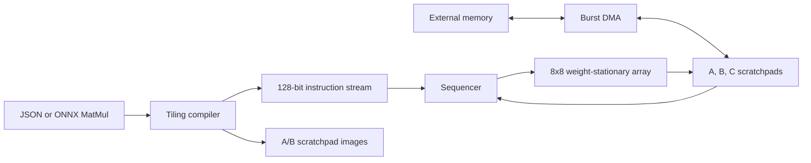

# SystolicForge NPU

SystolicForge is a from-scratch INT8 matrix accelerator built as a portfolio-quality
AI-chip project. It starts with a parameterized weight-stationary systolic array,
wraps that array in a programmable mini-NPU, adds burst DMA and strided
scratchpads, and includes FPGA, Sky130, and compiler flows.

The default compute engine is **8×8**: 64 signed INT8 MACs operate every cycle
once the wavefront is full. `ROWS` and `COLS` are parameters, so the same RTL can
be elaborated as a 16×16 array when the target has enough resources.



## What is implemented

- Signed INT8 × INT8 processing elements with signed 32-bit accumulation.
- Weight-stationary dataflow with activation skew, eastward activation
  propagation, and southward partial-sum propagation.
- A parameterized 8×8/16×16-capable array with one-cycle-per-row streaming.
- A 128-bit mini-NPU ISA with `NOP`, strided `MATMUL`, and `HALT`.
- A/B/C scratchpads, K-tile accumulation, an instruction sequencer, and faults
  for illegal tile sizes/opcodes.
- A word-burst DMA with external valid/ready read and write channels.
- A dependency-free JSON compiler plus an optional ONNX frontend.
- A Basys3 self-test top, XDC, and non-project Vivado build script.
- OpenLane 2 and OpenROAD-flow-scripts configurations for Sky130.
- Self-checking RTL and compiler regressions suitable for CI.

## Verification status

The local regression currently passes:

| Test | Coverage | Result |
|---|---|---:|
| Systolic core | Signed values, lane order, input bubble, 4×4 array | PASS |
| Mini-NPU | Two instructions, K=6 split 4+2, accumulation, strides | PASS |
| DMA | Five-word external→local and local→external bursts | PASS |
| FPGA demo | Complete on-chip 8×8 self-test | PASS |
| Compiler | Encoding, M/K/N tiling, images, golden output, errors | PASS |
| Compiler → RTL | Generated five-word program and 60 golden outputs | PASS |
| Generic synthesis | 64 PEs, structural check, synthesized-netlist simulation | PASS |
| Xilinx-7 mapping | 64 array DSPs; 66 DSP48E1 cells including self-test | PASS |

Run everything on Windows:

```powershell
powershell -ExecutionPolicy Bypass -File scripts\run_all_tests.ps1
```

Or on Linux/macOS with Icarus Verilog:

```sh
make test
```

With Yosys installed:

```sh
make synth       # generic gate netlist and saved report
make gate-sim    # run the synthesized 8x8 netlist against the testbench
make synth-xc7   # Xilinx 7-series resource mapping for the Basys3 demo
```

The regression needs Python 3.10+ and Icarus Verilog. The JSON compiler has no
third-party Python dependency.

## Compile a MatMul

```sh
python compiler/systolicforge_compile.py examples/matmul.json \
  -o build/example_program --array-rows 8 --array-cols 8
```

The compiler produces:

- `program.hex`: one 128-bit instruction per line, terminated by `HALT`;
- `a.hex` and `b.hex`: two's-complement INT8 scratchpad images;
- `c_expected.hex`: the signed INT32 golden result;
- `manifest.json`: dimensions, tile schedule, scales, and memory footprints.

For a single-MatMul ONNX model, install the optional `onnx` package and pass the
model path. B must be an initializer. If A is dynamic, provide its values with
`--a-data input.json`. Floating-point inputs are symmetrically quantized per
tensor and their scales are recorded in the manifest.

## FPGA and ASIC flows

For Basys3:

```sh
vivado -mode batch -source fpga/vivado/build_basys3.tcl
```

The generated bitstream runs an on-chip signed-matmul self-test. BTNU resets,
BTNC starts, LED0 means pass, LED1 means fail, and LED2 means busy. Reports and
the bitstream land in `build/vivado_basys3/`.

For Sky130 with OpenLane 2:

```sh
openlane pd/openlane/config.json
python scripts/collect_openlane_metrics.py <openlane-run-directory>
```

Generic and Xilinx-7 synthesis have been run with Yosys 0.33; the reproducible
results are recorded in [docs/SYNTHESIS.md](docs/SYNTHESIS.md). Vivado,
OpenLane/OpenROAD, and a Sky130 PDK are not installed, so post-route FPGA timing
and ASIC PPA numbers are deliberately not claimed yet. The supplied flows
generate those reports on a machine with the corresponding tools installed.

## Repository map

```text
rtl/        PE, systolic array, mini-NPU, DMA, integrated SoC
tb/         self-checking SystemVerilog testbenches
compiler/   MatMul frontend, quantizer, tiler, encoder
examples/   example graph
fpga/       Basys3 wrapper, constraints, Vivado flow
pd/         Sky130 constraints and OpenLane/OpenROAD configs
synth/      generic Yosys synthesis script
docs/       architecture, ISA, FPGA, and physical-design notes
scripts/    Windows regressions and report extraction
tests/      Python compiler tests
```

The detailed design is in [docs/ARCHITECTURE.md](docs/ARCHITECTURE.md), the
binary contract is in [docs/ISA.md](docs/ISA.md), and synthesis evidence is in
[docs/SYNTHESIS.md](docs/SYNTHESIS.md).
