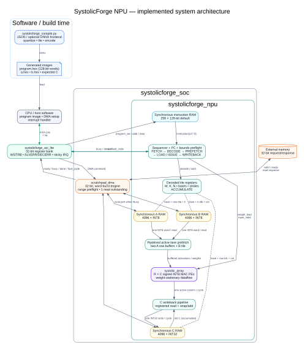
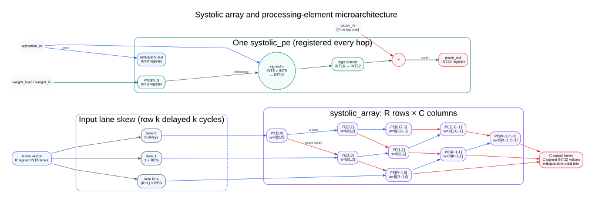
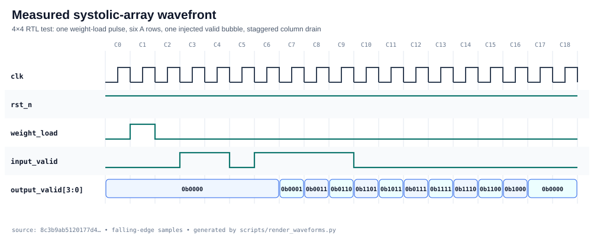
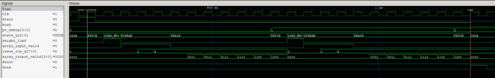

# Architecture and microarchitecture

This document describes the RTL currently implemented in this repository. Each
claim is tied to a named module or to a measured simulation trace; proposed
features are not shown as implemented blocks.

## System architecture



The top-level hardware integration is `systolicforge_soc`. It connects the
external request/response interface to `scratchpad_dma`, then connects the DMA's
local port to `systolicforge_npu`. Compute start is accepted only while the DMA
is idle, and the NPU exposes its scratchpad configuration port only while
compute is idle.

### RTL and software anchors

| Diagram block or path | Implemented evidence |
|---|---|
| SoC integration and compute/DMA exclusion | [`rtl/systolicforge_soc.sv`](../rtl/systolicforge_soc.sv#L41-L105) |
| Compiler-to-external-memory integrated regression | [`tb/tb_systolicforge_soc.sv`](../tb/tb_systolicforge_soc.sv) |
| Instruction memory, A/B/C scratchpads, and decoded tile registers | [`rtl/systolicforge_npu.sv`](../rtl/systolicforge_npu.sv#L53-L79) |
| Instruction decode and five-state sequencer | [`rtl/systolicforge_npu.sv`](../rtl/systolicforge_npu.sv#L179-L253) |
| Weight and activation address generation | [`rtl/systolicforge_npu.sv`](../rtl/systolicforge_npu.sv#L120-L141) |
| Per-column result capture and optional C accumulation | [`rtl/systolicforge_npu.sv`](../rtl/systolicforge_npu.sv#L255-L278) |
| Burst DMA ready/valid state machine | [`rtl/scratchpad_dma.sv`](../rtl/scratchpad_dma.sv#L39-L146) |
| Quantization, M/K/N tiling, and instruction emission | [`compiler/systolicforge_compile.py`](../compiler/systolicforge_compile.py) |

The instruction configuration port is intentionally separate from the data DMA.
It can be replaced by AXI-Lite, APB, or a boot ROM in a board-specific wrapper
without changing the compute datapath.

## Systolic-array microarchitecture



The physical array contains `ROWS × COLS` instances of `systolic_pe`. For a
MATMUL tile, `ROWS` is the maximum K tile and `COLS` is the maximum N tile.
Inactive rows and columns receive zero when a tile is smaller than the physical
array.

### Processing element

Each PE has three registered paths:

| Path | Behavior | RTL evidence |
|---|---|---|
| Stationary weight | `weight_q` captures signed INT8 `weight_in` only when `weight_load` is high | [`rtl/systolic_pe.sv`](../rtl/systolic_pe.sv#L34-L45) |
| Activation | Signed INT8 activation and its valid bit advance one column east every cycle | [`rtl/systolic_pe.sv`](../rtl/systolic_pe.sv#L47-L48) |
| Partial sum | Signed INT16 product is sign-extended and registered as signed INT32; lower rows add `psum_in` | [`rtl/systolic_pe.sv`](../rtl/systolic_pe.sv#L31-L58) |

Top-row PEs start a new reduction with their product. Every lower PE requires
both activation-valid and partial-sum-valid before adding. Arithmetic wraps on
signed 32-bit overflow; the current RTL does not saturate.

### Logical matrices versus the physical PE array

Matrix dimensions and PE-array dimensions are related, but they are not the
same thing:

```text
A[M x K] x B[K x N] = C[M x N]

physical array: ARRAY_ROWS x ARRAY_COLS
instruction tile: K_tile <= ARRAY_ROWS, N_tile <= ARRAY_COLS
```

| Quantity | Meaning in this design |
|---|---|
| `M` | Number of logical output rows. Rows of A are streamed over time, so M does not determine the physical PE-row count. |
| `K` | Reduction dimension. At most `ARRAY_ROWS` K elements are handled by one MATMUL instruction. |
| `N` | Number of logical output columns. At most `ARRAY_COLS` columns are handled by one instruction. |
| `ARRAY_ROWS x ARRAY_COLS` | Physical PE grid and the maximum K-by-N tile computed by one instruction. |

This distinction explains the different dimensions used by the regressions:

| Context | Physical PE array | Logical matrices | Purpose |
|---|---:|---|---|
| Direct array RTL test | 4x4 | A=6x4, B=4x4, C=6x4 | Streams six A rows, injects a valid bubble, and checks 24 results. The `6x4` value describes A, not a 6x4 PE array. |
| Mini-NPU timing test | 4x4 | A=3x6, B=6x3, C=3x3 | Forces K=6 to split into K=4 and K=2 instructions and verifies C accumulation. |
| Default synthesizable configuration | 8x8 | Workload-dependent | Provides 64 physical INT8 MACs; software tiles larger matrices to it. |

The checked-in tests do not currently contain a five-column configuration. If
an earlier experiment used A=6x4 and B=4x5, its result would have been C=6x5
and its natural physical tile would have been 4x5. The first number of A (`M=6`)
still would not represent the PE-array row count.

### Weight-stationary wavefront

Before streaming a tile, the sequencer asserts `weight_load` for one cycle and
the complete K×N B tile is captured in the PE weight registers. One logical A
row is then issued on every `STREAM` cycle.

Lane `k` passes through `k` input-skew registers before entering array row `k`.
Inside the array, activations advance east and partial sums advance south. This
aligns `A[m][k] × B[k][n]` at each PE without a combinational reduction tree.
Counting the input sampling edge as the first registered PE stage, output column
`c` crosses `ROWS + c` registered stages. Each output column therefore has its
own valid bit and adjacent columns drain one cycle apart.

The relevant generated structures are the input skew registers, activation
buses, partial-sum buses, and nested PE array in
[`rtl/systolic_array.sv`](../rtl/systolic_array.sv#L20-L99).

## Measured array timing



This trace comes from the self-checking 4×4 array testbench. It shows one weight
load, six streamed A rows, an injected one-cycle input-valid bubble, and the
staggered four-column drain. The `output_valid[3:0]` ramp (`0001`, `0011`,
`0111`, `1111`) is the observed wavefront reaching successive columns; the
bubble then propagates through the same valid pipeline.

The stimulus and checks are in
[`tb/tb_systolic_array.sv`](../tb/tb_systolic_array.sv#L96-L161). The committed
SVG is rendered from its VCD rather than drawn manually.

## Mini-NPU sequencer

`systolicforge_npu` wraps the array with a 128-bit instruction memory, separate
signed INT8 A/B scratchpads, a signed INT32 C scratchpad, a program counter, and
the following controller states:

| State | Work performed | Exit condition |
|---|---|---|
| `IDLE` | Accept `start`, clear prior fault, set `busy` | `start` |
| `FETCH` | Read/decode instruction; validate opcode, tile dimensions, PC, and complete A/B/C address ranges | NOP, MATMUL, HALT, or fault |
| `LOAD_WEIGHTS` | Assert `weight_load` for the current K×N B tile | One cycle |
| `STREAM` | Issue one A row per cycle | `m` rows issued |
| `DRAIN` | Capture staggered array outputs into C | Last active column of last row |

K dimensions larger than `ARRAY_ROWS` use multiple MATMUL instructions. The
first replaces C; later instructions set `ACCUMULATE` and add partial results to
the existing C entry. N is tiled across array columns, while M is split only
when it exceeds the ISA's 255-row field.

## Measured instruction timing



*Figure: GTKWave display of the Icarus VCD generated by the self-checking
mini-NPU regression. The white marker is the accepted start and the red marker
is the HALT completion pulse.*

This is the repository's physical 4x4 mini-NPU regression executing logical
A=3x6, B=6x3, C=3x3. Its instruction stream is:

| PC | Instruction | Work performed |
|---:|---|---|
| 0 | `MATMUL M=3, K=4, N=3`, `ACCUMULATE=0` | Compute K indices 0 through 3 and replace C. |
| 1 | `MATMUL M=3, K=2, N=3`, `ACCUMULATE=1` | Compute K indices 4 and 5 and add the partial result to C. |
| 2 | `HALT` | Deassert `busy`, pulse `done`, and return to `IDLE`. |

The left GTKWave value column is a snapshot at the red `DONE` cursor; it is not
a summary of every value in the trace.

| Trace | Definition | Observed behavior and significance |
|---|---|---|
| `clk` | Sequential simulation clock | 10 ns period (100 MHz testbench clock). This is a stimulus frequency, not FPGA timing-closure evidence. |
| `start` | Execution request sampled in `IDLE` | Pulses for one cycle at `START_ACCEPTED`; the controller starts at PC 0. It is 0 at the done cursor. |
| `busy` | Program-in-progress status | Rises when start is accepted, stays high across both MATMULs, and falls when PC 2 decodes HALT. |
| `pc_debug[3:0]` | Current instruction-memory address | Advances 0 to 1 to 2. At the cursor it remains 2, the HALT address. |
| `state_q[2:0]` | Sequencer state | Repeats `FETCH -> LOAD_W -> STREAM -> DRAIN` for PCs 0 and 1, then returns to `IDLE` after HALT. |
| `weight_load` | PE weight-register enable | High for exactly one `LOAD_W` cycle per MATMUL tile. |
| `array_input_valid` | Valid qualifier for the activation vector | High for three `STREAM` cycles per instruction because M=3 logical rows are issued. |
| `issue_row_q[7:0]` | Logical A/C row being issued | Counts 0, 1, 2 for each instruction. It remains 2 at completion because HALT does not clear this debug register. |
| `array_output_valid[3:0]` | Per-physical-column output qualifiers | Shows the registered result wavefront entering and leaving successive array columns. Only active logical columns 0 through 2 are committed to C. |
| `fault` | Illegal opcode or illegal tile-shape indication | Remains 0, so both MATMUL instructions passed controller validation and HALT was recognized. |
| `done` | One-cycle program-completion pulse | Becomes 1 when PC 2 executes HALT, then clears on the following cycle. |

The five state encodings displayed by the GTKWave translation filter are:

| Encoding | Display | Controller action |
|---:|---|---|
| `000` | `IDLE` | Wait for `start`. |
| `001` | `FETCH` | Decode the instruction at `pc_debug`. |
| `010` | `LOAD_W` | Capture the current B tile into stationary PE weights. |
| `011` | `STREAM` | Issue one logical A row per cycle. |
| `100` | `DRAIN` | Capture staggered array results until the last active column and row arrive. |

`array_output_valid` is displayed as `[3:0]`, so the leftmost digit is physical
column 3. Its ramp decodes as follows:

| Value | Physical columns carrying a valid result |
|---|---|
| `0001` | 0 |
| `0011` | 1 and 0 |
| `0111` | 2, 1, and 0 |
| `1110` | 3, 2, and 1 |
| `1100` | 3 and 2 |
| `1000` | 3 |
| `0000` | None; the pipeline is drained. |

Physical column 3 still receives a valid wavefront because the instantiated
array has four columns, but N=3. The result-capture logic ignores that column
because it only writes columns where `capture_col < n_size_q`.

The markers are 230 ns apart. With a 10 ns period, the measured start-to-done
latency is therefore 23 cycles, matching the testbench's printed result. The
waveform proves controller ordering, tile issue, wavefront timing, completion,
and absence of a controller fault. Numerical correctness is established by the
self-checking testbench's comparison of all nine C entries; `array_results` and
C scratchpad data are not displayed in this screenshot.

The exact instructions, matrices, golden-model comparison, and timeout are in
[`tb/tb_systolicforge_npu.sv`](../tb/tb_systolicforge_npu.sv#L141-L225).
Trace hashes and the regeneration contract are in
[`diagrams/WAVEFORM_EVIDENCE.md`](diagrams/WAVEFORM_EVIDENCE.md).

## DMA behavior

`scratchpad_dma` accepts a local memory selector, local word address, external
byte address, direction, and word count. It keeps at most one external read
outstanding:

- A command is accepted only if its memory selector, complete local range,
  complete external byte range, and word alignment are valid. Rejection pulses
  `dma_done` with a structured fault code before any external request.
- A zero-length command is a successful no-op and emits no local or external
  transaction.

- A load alternates `DMA_LOAD_REQ` and `DMA_LOAD_WAIT`, writing a local word
  only when the external response and local ready signals are both asserted.
- A store holds the external write request in `DMA_STORE_REQ` until both local
  and external ready are asserted.
- Each completed beat increments the local address by one word and the external
  address by four bytes.

A/B scratchpads consume the low byte of each loaded word; C consumes all 32
bits. The five-word load/store regression is implemented in
[`tb/tb_scratchpad_dma.sv`](../tb/tb_scratchpad_dma.sv).

## Throughput and limits

An R×C array contains R×C MACs. At full utilization:

```text
MAC/s = R × C × clock_frequency
ops/s = 2 × MAC/s
```

Thus the default 8×8 array has a peak of 64 MAC/cycle, or 12.8 GOPS at 100 MHz
when a multiply and add count as two operations. This is a peak datapath rate,
not a measured application throughput claim. Utilization is reduced by partial
tiles, array fill/drain, weight loading, DMA traffic, and instruction gaps.

The controller rejects zero dimensions, K tiles larger than `ARRAY_ROWS`, N
tiles larger than `ARRAY_COLS`, unknown opcodes, instruction-memory overrun,
and any strided A/B/C range outside the physical scratchpads. The compiler
enforces the same address limits before emission. The structured fault-code
contract and recovery behavior are documented in [`ISA.md`](ISA.md#fault-reporting).

## Reproduce the evidence

With Icarus Verilog, Verilator, Yosys, Python 3, and Graphviz installed:

```sh
make evidence
```

That target runs the complete functional regression, Verilator lint, generic
synthesis plus synthesized-netlist simulation, Xilinx-7 mapping, VCD capture,
waveform rendering, and DOT diagram rendering. The lint command explicitly
waives `WIDTHEXPAND` for parameterized address arithmetic and `UNUSEDSIGNAL` for
reserved/high instruction bits; all other warnings fail lint. Synthesis
results are recorded separately in
[`SYNTHESIS.md`](SYNTHESIS.md).
