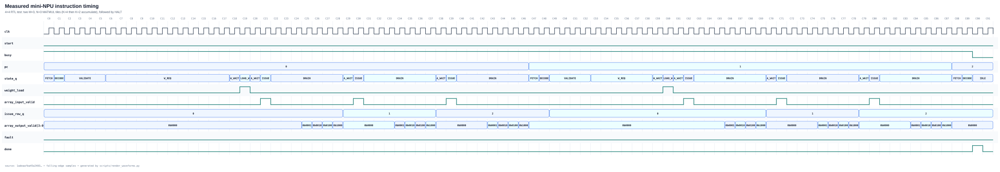

# Architecture and microarchitecture

This document describes the RTL currently implemented in this repository. Each
claim is tied to a named module or to a measured simulation trace; proposed
features are not shown as implemented blocks.

The full-depth synchronous-memory replacement is implemented and locally
verified; Vivado and board evidence remain pending. Its fixed
interfaces, memory contract, migration stages, and acceptance criteria are in
[MEMORY_ARCHITECTURE_REDESIGN.md](MEMORY_ARCHITECTURE_REDESIGN.md).

## System architecture


The host-facing integration is `systolicforge_axi_lite`, a 32-bit AXI4-Lite
register wrapper around `systolicforge_soc`. The SoC connects the external
request/response interface to `scratchpad_dma`, then connects the DMA's local
port to `systolicforge_npu`. Compute start is accepted only while the DMA is
idle, and the NPU exposes its scratchpad configuration port only while compute
is idle.

For the Basys3 demonstration, `systolicforge_fpga_uart_demo` combines the UART
command parser with `systolicforge_fpga_engine`. The board engine implements the
same NOP/MATMUL/HALT instruction fields, scratchpad programming contract,
tiling, accumulation, and faults, but serializes A/B reads into tile registers.
The board engine uses compact distributed RAM, while the general NPU now uses
full-depth synchronous block RAM. Both retain the 8×8 compute datapath.

### RTL and software anchors

| Diagram block or path | Implemented evidence |
|---|---|
| AXI4-Lite register bank, command responses, and interrupt retention | [`rtl/systolicforge_axi_lite.sv`](../rtl/systolicforge_axi_lite.sv) |
| Host-driven program/DMA/compute regression | [`tb/tb_systolicforge_axi_lite.sv`](../tb/tb_systolicforge_axi_lite.sv) |
| Basys3 UART parser, shared-engine self-test, and LED status | [`fpga/common/systolicforge_fpga_uart_demo.sv`](../fpga/common/systolicforge_fpga_uart_demo.sv) |
| FPGA-oriented ISA engine with serialized scratchpad reads | [`fpga/common/systolicforge_fpga_engine.sv`](../fpga/common/systolicforge_fpga_engine.sv) |
| Bit-level UART program/execute/result regression | [`tb/tb_fpga_uart_demo.sv`](../tb/tb_fpga_uart_demo.sv) |
| Board host client and compiler upload path | [`scripts/systolicforge_uart_host.py`](../scripts/systolicforge_uart_host.py) |
| SoC integration and compute/DMA exclusion | [`rtl/systolicforge_soc.sv`](../rtl/systolicforge_soc.sv#L41-L105) |
| Compiler-to-external-memory integrated regression | [`tb/tb_systolicforge_soc.sv`](../tb/tb_systolicforge_soc.sv) |
| Synchronous instruction/A/B/C RAM and tile registers | [`rtl/systolicforge_npu.sv`](../rtl/systolicforge_npu.sv), [`rtl/systolicforge_sdp_ram.sv`](../rtl/systolicforge_sdp_ram.sv) |
| Scheduled fetch, prefetch, issue and writeback sequencer | [`rtl/systolicforge_npu.sv`](../rtl/systolicforge_npu.sv) |
| Burst DMA ready/valid state machine | [`rtl/scratchpad_dma.sv`](../rtl/scratchpad_dma.sv#L39-L146) |
| Quantization, M/K/N tiling, and instruction emission | [`compiler/systolicforge_compile.py`](../compiler/systolicforge_compile.py) |

The instruction configuration port remains separate from the data DMA inside
the SoC. The AXI4-Lite wrapper stages four 32-bit words before committing one
128-bit instruction, so adding the host boundary does not change the compute
datapath or ISA.

## AXI4-Lite host boundary

The wrapper accepts independent AXI AW and W channels in either order and keeps
at most one read and one write response outstanding. It exposes identity,
status, program staging, DMA staging, and interrupt registers. Unmapped or
unaligned accesses return `DECERR`; writes to read-only registers and commands
that cannot be accepted return `SLVERR` instead of being silently discarded.

Compute and DMA completion pulses set sticky interrupt bits. The fault
interrupt reflects a live retained hardware condition, so a write-one-to-clear
cannot hide an active NPU or DMA fault. Software recovers the underlying engine
first, then clears the interrupt status. The full register map, access rules,
driver sequence, and C constants are in [`HOST_INTERFACE.md`](HOST_INTERFACE.md)
and [`include/systolicforge_regs.h`](../include/systolicforge_regs.h).

## Basys3 UART boundary

The board top has one engine owner at a time. UART commands can write
instructions and A/B/C words, start execution, and read status/results while
the engine is idle.
The retained BTNC self-test uses the same ports to load a deterministic 8×8
program and verify all 64 results. Commands with side effects return `busy`
while compute or the button test owns the engine; PING and STATUS remain
available.

The UART uses fixed command payloads and fixed six-byte responses, so the RTL
does not need packet buffering, a checksum engine, or a soft CPU. A two-flop
synchronizer precedes the 8N1 receiver, framing and command errors are sticky,
and the host sends only one outstanding request. The full byte layout and the
compact board memory configuration are in [`UART_PROTOCOL.md`](UART_PROTOCOL.md).

The board engine prefetches one 8×8 B tile over 64 cycles and one A row over
eight cycles before pulsing the array input. Issuing rows nine cycles apart
guarantees at most one active output column per cycle, allowing a single C
scratchpad write port. The full-depth engine has its own synchronous read and
writeback schedule with the same ISA and PE array. The compiled 6×10 example still
executes as four tiled MATMUL instructions plus HALT and matches all 60 golden
outputs in the FPGA-engine regression.

## Systolic-array microarchitecture


The physical array contains `ROWS × COLS` instances of `systolic_pe`. For a
MATMUL tile, `ROWS` is the maximum K tile and `COLS` is the maximum N tile.
Inactive rows and columns receive zero when a tile is smaller than the physical
array.

### Processing element

Each PE has three registered paths:

| Path | Behavior | RTL evidence |
|---|---|---|
| Stationary weight | `weight_q` captures signed INT8 `weight_in` only when `weight_load` is high | [`rtl/systolic_pe.sv`](../rtl/systolic_pe.sv#L34-L45) |
| Activation | Signed INT8 activation and its valid bit advance one column east every cycle | [`rtl/systolic_pe.sv`](../rtl/systolic_pe.sv#L47-L48) |
| Partial sum | Signed INT16 product is sign-extended and registered as signed INT32; lower rows add `psum_in` | [`rtl/systolic_pe.sv`](../rtl/systolic_pe.sv#L31-L58) |

Top-row PEs start a new reduction with their product. Every lower PE requires
both activation-valid and partial-sum-valid before adding. Arithmetic wraps on
signed overflow; the current RTL does not saturate. The dedicated array edge
regression uses a verification-only 16-bit accumulator so a 4x4 reduction of
`127 * 127` reaches 64516 and must wrap to `16'hfc04` (`-1020`). It also checks
zero activations against nonzero weights. Production/default configurations
retain signed 32-bit accumulation.

### Logical matrices versus the physical PE array

Matrix dimensions and PE-array dimensions are related, but they are not the
same thing:

```text
A[M x K] x B[K x N] = C[M x N]

physical array: ARRAY_ROWS x ARRAY_COLS
instruction tile: K_tile <= ARRAY_ROWS, N_tile <= ARRAY_COLS
```

| Quantity | Meaning in this design |
|---|---|
| `M` | Number of logical output rows. Rows of A are streamed over time, so M does not determine the physical PE-row count. |
| `K` | Reduction dimension. At most `ARRAY_ROWS` K elements are handled by one MATMUL instruction. |
| `N` | Number of logical output columns. At most `ARRAY_COLS` columns are handled by one instruction. |
| `ARRAY_ROWS x ARRAY_COLS` | Physical PE grid and the maximum K-by-N tile computed by one instruction. |

This distinction explains the different dimensions used by the regressions:

| Context | Physical PE array | Logical matrices | Purpose |
|---|---:|---|---|
| Direct array RTL test | 4x4 | A=6x4, B=4x4, C=6x4 | Streams six A rows, injects a valid bubble, and checks 24 results. The `6x4` value describes A, not a 6x4 PE array. |
| Mini-NPU timing test | 4x4 | A=3x6, B=6x3, C=3x3 | Forces K=6 to split into K=4 and K=2 instructions and verifies C accumulation. |
| Default synthesizable configuration | 8x8 | Workload-dependent | Provides 64 physical INT8 MACs; software tiles larger matrices to it. |

The checked-in tests do not currently contain a five-column configuration. If
an earlier experiment used A=6x4 and B=4x5, its result would have been C=6x5
and its natural physical tile would have been 4x5. The first number of A (`M=6`)
still would not represent the PE-array row count.

### Weight-stationary wavefront

Before streaming a tile, the sequencer asserts `weight_load` for one cycle and
the complete K×N B tile is captured in the PE weight registers. One logical A
row is issued when the controller pulses `array_input_valid`. The array itself
can accept a row every cycle; the scheduled NPU issues rows less frequently.

Lane `k` passes through `k` input-skew registers before entering array row `k`.
Inside the array, activations advance east and partial sums advance south. This
aligns `A[m][k] × B[k][n]` at each PE without a combinational reduction tree.
Counting the input sampling edge as the first registered PE stage, output column
`c` crosses `ROWS + c` registered stages. Each output column therefore has its
own valid bit and adjacent columns drain one cycle apart.

The relevant generated structures are the input skew registers, activation
buses, partial-sum buses, and nested PE array in
[`rtl/systolic_array.sv`](../rtl/systolic_array.sv#L20-L99).

## Measured array timing


This trace comes from the self-checking 4×4 array testbench. It shows one weight
load, six streamed A rows, an injected one-cycle input-valid bubble, and the
staggered four-column drain. The `output_valid[3:0]` ramp (`0001`, `0011`,
`0111`, `1111`) is the observed wavefront reaching successive columns; the
bubble then propagates through the same valid pipeline.

The stimulus and checks are in
[`tb/tb_systolic_array.sv`](../tb/tb_systolic_array.sv#L96-L161). The committed
SVG is rendered from its VCD rather than drawn manually.

## Mini-NPU sequencer

The general NPU uses four synchronous SDP RAM instances for instruction memory
and A/B/C. Defaults remain 4096 words per scratchpad and 256 instructions.

| State | Work performed |
|---|---|
| IDLE | Accept start while no local memory request is active |
| FETCH / DECODE | Synchronous instruction fetch; validate opcode, dimensions, PC and full address ranges |
| WEIGHT_REQ / WEIGHT_WAIT | Issue active B reads consecutively; wait for the final registered response |
| LOAD_WEIGHTS | Load the buffered tile into the PEs |
| ACT_WAIT | Wait for the selected activation buffer to be ready |
| ISSUE | Pulse array input valid for one logical row |
| DRAIN | Capture outputs and commit pipelined C writes |

An independent A prefetch pipeline fills two alternating row buffers while
weights are fetched and the current array row drains. It stops when both
buffers are occupied and resumes when ISSUE consumes one. Read address/index
metadata is delayed with RAM data. Only active K/N lanes are read; inactive
array lanes are masked to zero. One logical array row is in flight at a time.
A C read and result/address metadata
are captured together; the following edge writes the result or wrapped INT32
accumulation. The next row begins after the row's last C write commits. PC
advances after the final row commits; HALT then pulses done. Overlapping C
strides execute in the row/column order specified by the ISA; concurrent writes
in the saved legacy engine could collide.

## Measured instruction timing



The 4x4 mini-NPU test executes A=3x6 and B=6x3 as K=4 replace and K=2 accumulate,
then HALT. It takes **82 simulation cycles** and verifies all nine C words.
The compiler-generated 8x8 example takes **478 compute cycles** and verifies
all 60 C words, including the full 4096/256 SoC configuration. The 10 ns
simulation clock is a stimulus, not routed frequency evidence.

The older GTKWave screenshot in `images/npu_instruction_timing.png` depicts
the legacy controller (23 cycles). Its five-state encoding does not describe
the current engine. The generated SVG above is the current trace; its hash is
in [diagrams/WAVEFORM_EVIDENCE.md](diagrams/WAVEFORM_EVIDENCE.md).

The initial synchronous-memory checkpoint (`f56b35c`) took 168 and 1246 cycles,
respectively. Pipelined active-lane reads and activation double buffering reduce
the example by 61.6% in cycles. C writeback still drains one array row before
the next is issued. Banking and multiple rows in flight remain performance
work; see [MEMORY_ARCHITECTURE_REDESIGN.md](MEMORY_ARCHITECTURE_REDESIGN.md).

## DMA behavior

`scratchpad_dma` accepts a local memory selector, local word address, external
byte address, direction, and word count. It keeps at most one external read
outstanding:

- A command is accepted only if its memory selector, complete local range,
  complete external byte range, and word alignment are valid. Rejection pulses
  `dma_done` with a structured fault code before any external request.
- A zero-length command is a successful no-op and emits no local or external
  transaction.

- A load alternates `DMA_LOAD_REQ` and `DMA_LOAD_WAIT`, writing a local word
  only when the external response and local ready signals are both asserted.
- A store holds the external write request in `DMA_STORE_REQ` until both local
  and external ready are asserted.
- Each completed beat increments the local address by one word and the external
  address by four bytes.

A/B scratchpads consume the low byte of each loaded word; C consumes all 32
bits. The five-word load/store regression is implemented in
[`tb/tb_scratchpad_dma.sv`](../tb/tb_scratchpad_dma.sv).

## Throughput and limits

An R×C array contains R×C MACs. At full utilization:

```text
MAC/s = R × C × clock_frequency
ops/s = 2 × MAC/s
```

Thus the default 8×8 array has a peak of 64 MAC/cycle, or 12.8 GOPS at 100 MHz
when a multiply and add count as two operations. This is a peak datapath rate,
not a measured application throughput claim. Utilization is reduced by partial
tiles, array fill/drain, weight loading, DMA traffic, and instruction gaps.

The controller rejects zero dimensions, K tiles larger than `ARRAY_ROWS`, N
tiles larger than `ARRAY_COLS`, unknown opcodes, instruction-memory overrun,
and any strided A/B/C range outside the physical scratchpads. The compiler
enforces the same address limits before emission. The structured fault-code
contract and recovery behavior are documented in [`ISA.md`](ISA.md#fault-reporting).

## Reproduce the evidence

With Icarus Verilog, Verilator, Yosys, Python 3, and Graphviz installed:

```sh
make evidence
```

That target runs the complete functional regression, Verilator lint, generic
synthesis plus synthesized-netlist simulation, Xilinx-7 mapping, VCD capture,
waveform rendering, and DOT diagram rendering. The lint command explicitly
waives `WIDTHEXPAND` for parameterized address arithmetic and `UNUSEDSIGNAL` for
reserved/high instruction bits; all other warnings fail lint. Synthesis
results are recorded separately in
[`SYNTHESIS.md`](SYNTHESIS.md).
